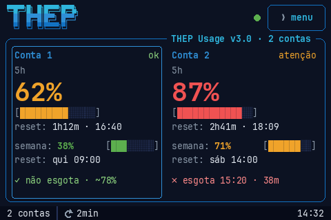
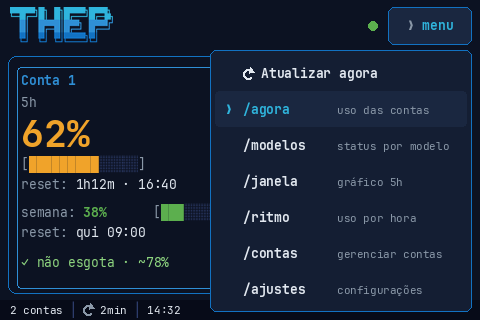
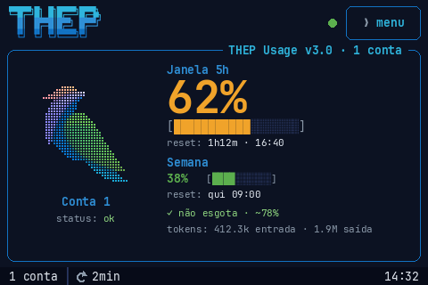
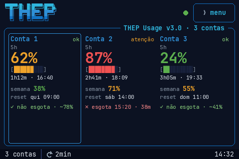
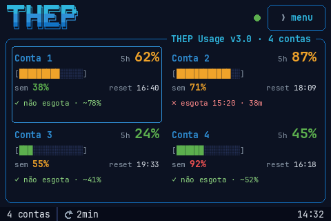
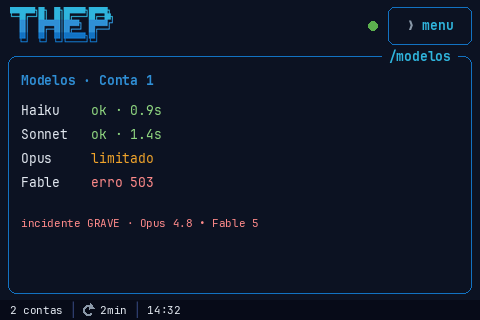
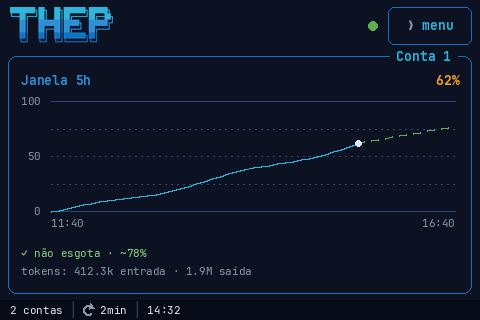
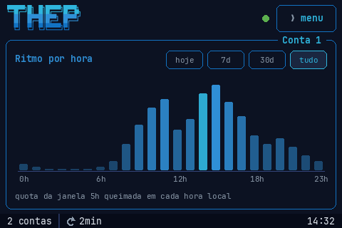
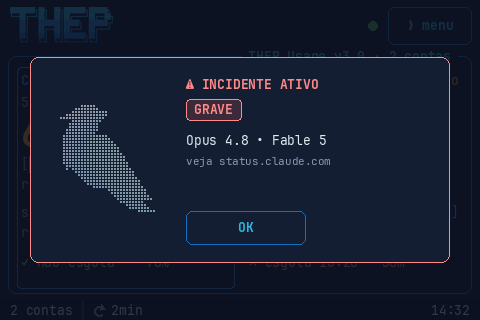
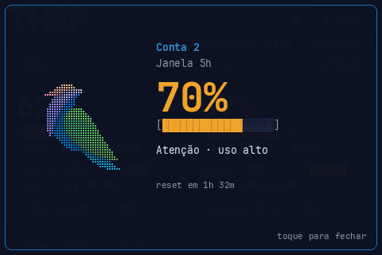

<div align="center">


# Claude Usage Stick

**Your Claude Code rate limits, live on a 3.5" touch screen.**<br>
No computer. No app. No cloud.

**English** · [Português](README.pt-BR.md)




</div>

The device queries Anthropic's API directly, reads your usage straight from the response headers,
and renders it on a dashboard: **every saved account side by side** (up to 4), a burn-rate
projection, reset clocks, an hour-of-day chart and a status dot that tells you at a glance whether
any account stopped updating.

> 100% touch navigation through a **menu** in the header (no swipe, no physical button). v3 drops
> the coral-and-Clawd look for a terminal-style UI in the spirit of the
> [Hermes Agent](https://github.com/NousResearch/hermes-agent) CLI, in the colors of
> **THEP**. Adapted from the original **Claude Usage Stick** project (a multi-board firmware with
> physical buttons) to run **on this screen only** — see
> [What came from the original project](#what-came-from-the-original-project).

> The on-screen UI is in Portuguese by default (English is one tap away in Settings). This README
> documents it in English; on-screen labels are quoted where useful.

---

## Getting one running


Everything you need is in this repository: the firmware source, the exact board, the pin map and
the build commands. Flashing it yourself with `arduino-cli` is documented in
[Build & flash](#build--flash) and **costs nothing**.

### Don't want to install a toolchain?

<a href="https://usagestick.autom.my"></a>

If you're short on time — or simply don't want to deal with `arduino-cli`, board packages and
libraries — there's a hosted flasher at **[usagestick.autom.my](https://usagestick.autom.my)**.
Create an account, plug the board into USB, and Chrome writes the firmware straight to it over Web
Serial. It takes about a minute and installs nothing on your machine.

That service charges a **small one-off fee per board**, which pays for hosting and for building the
convenience. To be explicit about what is being sold:

- **You are not paying for the firmware.** It is open source, it is right here, and you can build
  and flash it for free, forever, without an account.
- The fee covers **the convenience** of doing it from a browser. It is entirely optional.
- One payment covers **one board, for good** — including future firmware versions on that board.

If you're comfortable with a terminal, skip it and use [Build & flash](#build--flash).

---

## Screens

> The images below are **mockups** rendered by `python3 tools/gen_mockups.py` with the firmware's
> own fonts (JetBrains Mono, from `tools/gen_fonts.sh`), images (`tools/gen_hermes_assets.py`) and
> geometry; the script also fails if any text would overflow its card. Real device photos coming
> soon.

After the PIN, the screen is a fixed **shell**:

- **Header:** the THEP logo, the [status dot](#status-dot) and the `❯ menu` button.
- **Panel:** a bordered box whose title sits on the border (`THEP Usage v3.0 · 2 contas` on the home
  screen, the focused account's label on the per-account screens).
- **Footer:** saved accounts (with `· N ✗` when N of them are failing), the refresh interval and
  the clock.

Polling and the local web server keep running whatever screen is open.

### Menu


`❯ menu` opens a list over the current screen; tap an item or anywhere outside to close it:

| Item | Opens |
|---|---|
| `↻ Atualizar agora` | refresh now (no effect while a cycle is already running) |
| `/agora` | home: account usage |
| `/modelos` | per-model status |
| `/janela` | 5-hour window chart |
| `/ritmo` | usage by hour |
| `/contas` | manage accounts |
| `/ajustes` | settings (About lives here) |

The commands are not translated. There is no automatic return to the home screen.

<br clear="right">

### Home (`/agora`)

One card per **saved** account, in slot order. The layout depends on how many accounts are saved
(1 to 4). A failing account keeps its column, so the layout never jumps around because of a network
blip.

 
 

| Accounts | Layout | Per account |
|---|---|---|
| 1 | THEP bird in braille + sections | label and API mark under the bird; 5 h % in 50 px, 18-block bar, reset (`1h12m · 16:40`), week % with a 10-block bar, week reset (`qui 09:00`), projection, and the [token count](#tokens-per-session-optional-bridge) when the bridge is running |
| 2 | 2 columns | label + API mark; 5 h % in 38 px, 14-block bar, reset, week % + 8-block bar, week reset, projection (secondary text in 13 px, rows spread over the card height) |
| 3 | 3 columns | label (up to 10 characters) + API mark; 5 h % in 30 px, 9-block bar, reset, week %, week reset, projection |
| 4 | 2×2 grid | label + 5 h % (20 px) on one line, 14-block bar, week % + 5 h reset clock, projection; no room for the API mark, so `atenção`/`limite` turn the 5 h % amber/red instead |

- **Levels** are fixed steps, for both windows: green below 50 %, amber from 50 % to under 80 %,
  red from 80 %.
- **API mark** comes from `anthropic-ratelimit-unified-status`: `allowed` → `ok` (green),
  `allowed_warning` or anything containing `warning` → `atenção` (amber), `rejected` /
  `rate_limited` / `exceeded` → `limite` (red); any other value is shown as-is, cut to 8
  characters.
- **Projection** is one line, computed by the same function as [`/janela`](#5-hour-window-janela):
  `✓ não esgota · ~78%` (won't run out; 78 % expected at the reset), `✗ esgota 15:20 · 38m` (runs
  out at 15:20, in 38 min), `✗ esgotada` (exhausted), `— sem histórico` (not enough samples yet).
  When the 5 h reset time has already passed but the next reading hasn't arrived, the card says
  `— janela reiniciou` and the reset line shows `passou · 16:40` instead of a frozen countdown.
- **Labels** longer than the card allows are cut with `…`.
- **Tap a card** to make that account the **focus** (used by `/modelos`, `/janela` and `/ritmo`).

#### When an account is failing

The card never turns into an error screen. In order of precedence:

1. Slot that could not be decrypted with this PIN: `SEM CHAVE`.
2. Failing, with no data yet (e.g. the first query after a token change came back 401): `⚠ AUTH`
   instead of the projection and `--%` instead of the 5 h %.
3. Failing, with older data: the last values stay on screen, dimmed, and the projection line
   becomes `⚠ <class> · <data age>`, e.g. `⚠ AUTH · 4m`.
4. Not queried yet (just unlocked, or new token): `consultando…` with `--%`.

| Class | Meaning |
|---|---|
| `AUTH` | 401 / 403 (the account is retried with backoff: it skips 1, 2, 4… cycles, up to 30 min, until the token is replaced) |
| `RATE` | 429 without usage headers |
| `ERR` | any other 4xx, 3xx, or 200 without usage headers |
| `SRV` | 5xx |
| `NET` | timeout, DNS, TLS, no HTTP code |
| `NOWIFI` | WiFi is down (the device keeps trying the saved networks) |
| `NOCLOCK` | no NTP time for more than 60 s after WiFi came up (TLS can't work without a clock) |

A 429 **with** usage headers is valid data (the account is at its limit), not a failure.

#### Status dot

The dot in the header sums up **every** account and pulses in 4 steps of opacity (1.6 s cycle):

| Color | When |
|---|---|
| Red `#f05252` | every account that has an answer is failing (includes no WiFi) |
| Yellow `#f0c419` | at least one account is failing |
| Blue `#2f8fd6` | first cycle after unlocking still running, or the last cycle ended less than 10 s ago with every account OK |
| Green `#5caf4e` | everything else |

An account that hasn't answered yet doesn't count as failing, so right after unlocking the dot is
never red.

### Models (`/modelos`)


- A text list, one line per model (Haiku / Sonnet / Opus / Fable), colored by result:
  `ok · 0.9s` (green, with latency) · `limitado` (amber, HTTP 429) · `AUTH` (401/403) · `NET`
  (network error) · `erro <code>` (any other code) · `n/d` (HTTP 404, gray) · `—` (not probed yet).
- The probe is **the focused account's own usage query**: each cycle it uses the next model in the
  rotation instead of the fixed one. If that model answers without usage headers, the account is
  re-queried right away with the fixed model, so a model being down never marks the account as
  failing.
- The last line is `status.claude.com`: `sem incidentes`, or the incident's severity and the models
  it names.
- The panel title is the focused account's label; tap it to move to the next account.

<br clear="right">

### 5-hour window (`/janela`)


- Chart of the focused account with the **X axis spanning exactly the current 5 h window**
  (start → reset).
- Solid line = real usage history; **dashed line = projection** at the current burn rate.
- The caption is the same projection text as the home cards, with room for the full sentence.
- The [token count](#tokens-per-session-optional-bridge) shows here too when the bridge is running.

<br clear="right">

### Hourly rhythm (`/ritmo`)


- **Usage by hour of day** for the focused account: 24 bars showing which hours burn the most
  quota; the current hour is highlighted.
- **Period selector**: **hoje / 7d / 30d / tudo** (today, last 7 days, last 30 days, all time).
  Per-day history is **persisted to flash** (31 days per account).

<br clear="right">

### Incident alert


When `status.claude.com` reports an **unresolved incident** on any model, an alert opens over
whatever screen is showing: *"⚠ INCIDENTE ATIVO"*, with the THEP bird grayed out and *"veja
status.claude.com"*. It answers the question that matters the moment something stalls: **is it you
or is it Anthropic?**

The **severity** Statuspage reports in the incident's `impact` field becomes a **chip** below the
title, and tints the border and title:

| `impact` | chip | color |
|---|---|---|
| `minor` | `LEVE` | amber `#f0a32a` |
| `major` | `GRAVE` | light red `#ff8a8a` |
| `critical` | `CRÍTICO` | red `#f05252` |
| `none` / missing | `IMPACTO NÃO DECLARADO` | amber `#f0a32a` |

**Every incident naming a model opens the alert** — none is silently suppressed. When there's no
usable severity, the chip says so outright instead of disappearing.

Below the chip come the **models named** by the incident, with the **version** when the incident
text says which (`Opus 4.6 • Sonnet 4.5`). With all four families affected the line collapses to
`Todos`. With no model named the line disappears — better to omit than to invent.

Tap anywhere (or `OK`) to dismiss. It **won't nag you again** for the duration of that incident —
it only comes back if the incident is resolved and a new one shows up, **or if the severity escalates** (a
`minor` turning `critical` re-alerts even after being dismissed). If severity changes while the
alert is open, it redraws in the new color.

<br clear="right">

### Threshold moments


Whenever an account's 5 h window or week crosses **25 % / 50 % / 70 % / 100 %**, a full-screen
"moment" pops up with the THEP bird, the account's label, the percentage counting up and a block
bar lighting up. The bird bounces at 25 % and 50 %, shakes at 70 % and goes gray at 100 %. Tap to
dismiss (auto-closes after 4.6 s).

Thresholds are tracked **per account**. If several accounts cross something in the same cycle, only
the highest one is shown; the others are marked as fired and don't repeat.

Stacking order, bottom to top: menu, threshold moment, incident alert.

<br clear="right">

### Settings (`/ajustes`)

A scrollable list, in this order:

- **Atualizar agora** (Refresh now).
- **Atualizar a cada** (Refresh every) — 30 s / 1 min / 2 min / 5 min, tap to cycle (default
  2 min; saved to NVS).
- **Idioma** (Language) — Português / English, applied to the whole UI.
- **Fuso** (Timezone) — tap to cycle through GMT−3, −4, −5, −6, −7, −8, −2, −1, 0, +1, +2, +3
  (default GMT−3). Nothing beyond GMT+3 or below GMT−8.
- **Brilho** (Brightness) — low / medium / high.
- **Configurar WiFi** — re-scan + password on screen. While this screen owns the radio, polling
  pauses (it shows *"aguardando a rede…"* until the query in flight finishes) and resumes when you
  leave.
- **Contas** (Accounts) — `N/4`, opens [`/contas`](#accounts-contas).
- **Trocar token** (Change token) — reopens the web token entry for the **focused** account.
- **Sobre** (About) — device info, firmware version, display model and credits.
- **Apagar tudo** (Erase everything) — factory reset (2 taps to confirm).

The v2.3 slideshow is gone; its NVS key is left in place (and ignored) so a rollback finds it.

### Accounts (`/contas`)

Got a personal **and** a work Claude subscription? The device holds **up to 4**, each with its own
label and its own encrypted slot, all behind the same PIN.

- **Tap a row to focus it.** The focused account is highlighted and marked `•  foco`. Focus only
  decides which account `/modelos`, `/janela` and `/ritmo` show (and which one carries the model
  probe); **every account is polled regardless**.
- **Pencil renames** on-screen; duplicate names get a " 2" suffix automatically, because the
  [token bridge](#tokens-per-session-optional-bridge) identifies accounts by label.
- **Trash removes** (2 taps to confirm), and it will not let you delete the last one. A result
  still in flight for a removed account is discarded.
- **+ Adicionar conta** reuses the web form, which takes a label along with the token.

---

## Hardware

| | |
|---|---|
| Screen | **Mini ESP32-S3 3.5" Capacitive Touch IPS · 480×320 · 8 MB PSRAM · 16 MB Flash** ([AliExpress](https://s.click.aliexpress.com/e/_c4T3hoZp)) |
| Chip | ESP32-S3 (native USB) |
| Display | **AXS15231B**, QSPI interface |
| Touch | **AXS15231B** capacitive, I²C `0x3B` |

> **Heads-up:** the AliExpress link above is an affiliate link. It costs you nothing extra, and the
> small commission goes straight back into keeping this project alive and updated. Buying the board
> through it is an easy way to support the work — thank you!

> **OPI PSRAM is mandatory** — the 480×320 LVGL buffer doesn't fit in internal RAM.

Pins and the validated display/color/touch configuration are in
[`firmware/REFERENCIA-HARDWARE-LVGL.md`](firmware/REFERENCIA-HARDWARE-LVGL.md) and the reference
bring-up sketch in [`firmware/bringup/`](firmware/bringup/).

The firmware sources and `firmware/REFERENCIA-HARDWARE-LVGL.md` call the board **Guition
JC4832W535**; sellers and the case below use **JC3248W535C**. Both names refer to this same 3.5"
ESP32-S3 + AXS15231B board (contributors have run the firmware on boards sold as JC3248W535C).

### 3D-printable case

A ready-to-print case for this display board is included:
[`3D Case/Case_JC3248W535C.stl`](3D%20Case/Case_JC3248W535C.stl) — print it, slide the board in
and the Usage Stick is desk-ready.

---

## How it works (and the token)

The gadget makes a **minimal** `POST` (`max_tokens: 1`) to
`https://api.anthropic.com/v1/messages` and **doesn't use the response body** — it reads usage
straight from the headers (`src/net/api.cpp`):

```
anthropic-ratelimit-unified-status                allowed | allowed_warning | rejected  (the API mark)
anthropic-ratelimit-unified-5h-utilization        0–1   (becomes the 5-hour window %)
anthropic-ratelimit-unified-5h-reset              epoch
anthropic-ratelimit-unified-5h-status
anthropic-ratelimit-unified-7d-utilization        0–1   (7-day window)
anthropic-ratelimit-unified-7d-reset              epoch
anthropic-ratelimit-unified-7d-status
anthropic-ratelimit-unified-reset                 epoch
anthropic-ratelimit-unified-representative-claim  five_hour | seven_day  (what limits you first)
anthropic-ratelimit-unified-fallback-percentage
anthropic-ratelimit-unified-overage-status / -overage-disabled-reason
```

**Every saved account is queried once per cycle**, one request at a time, on a dedicated network
task, so the screen keeps responding to touch while requests are in flight. A new cycle starts one
interval **after the previous one ends** (no overlap). Each request has a 5 s connect, 5 s TLS
handshake and 8 s read timeout; if a request is still running after 90 s, the device writes the
reason to NVS and restarts (you'll be asked for the PIN again).

The **per-model probe** rides on the focused account's query (see [`/modelos`](#models-modelos)),
so it costs no extra request in the normal case.

Model health comes from `status.claude.com/api/v2/incidents/unresolved.json`, fetched **every
5 minutes** (`STATUS_POLL_SEC`), once for all accounts. Unresolved incidents name the model family
in their own text, so a keyword scan is all the parsing needed (`src/net/status.cpp`), which also
picks the highest `impact` in the list. That's what fires the [incident alert](#incident-alert).

### What polling every account costs

Every poll is a real (minimal) API request, **visible to your org's admins** like any Claude Code
usage. With every account polled, the count is *accounts × cycles per hour*:

| Interval | 1 account | 2 accounts | 4 accounts |
|---|---|---|---|
| 30 s | 120 /h | 240 /h | 480 /h |
| 1 min | 60 /h | 120 /h | 240 /h |
| 2 min (default) | 30 /h | 60 /h | 120 /h |
| 5 min | 12 /h | 24 /h | 48 /h |

Add the occasional retry when the rotating probe model answers without usage headers. Each request
is `max_tokens: 1` with a few input tokens, so quota consumption is negligible — but on a corporate
account the **volume** is what admins see. v2.3 polled only the active account; if that matters to
you, pick a longer interval or keep fewer accounts on the device. An account rejected with 401/403
backs off on its own (up to 30 min between tries).

### Tokens per session (optional bridge)

The API does **not** expose token counts for subscription accounts — the `unified-*` headers only
carry utilization percentages, and `/api/oauth/usage` requires the `user:profile` scope (the
`setup-token` only has `user:inference`) and still returns percentages. The real numbers live in
the **local Claude Code transcripts** (`<config dir>/projects/**/*.jsonl`, `~/.claude` by default).

[`tools/token_bridge.py`](tools/token_bridge.py) (stdlib only) closes that gap: it asks the device
for the account's current window (`GET http://claude-stick.local/window?account=<label>`), sums the
transcript `usage` entries since the window start (deduped by message id, searching every
subfolder of `projects/`) and pushes them back (`POST /tokens`). The single-account home screen and
`/janela` then show *"tokens: 1.2M entrada · 88k saída"*. The count disappears when it goes stale
(more than 15 min without a push).

The payload carries `in` (input + cache-creation tokens), `out`, `cache` (cache reads) and
`sessions`; the device stores all four and shows `in`/`out`.

```bash
python3 tools/token_bridge.py                              # one shot, focused account
python3 tools/token_bridge.py --loop 120                   # keep pushing every 2 min
python3 tools/token_bridge.py --host 192.168.0.42          # if mDNS doesn't resolve
```

The device advertises itself via mDNS as **`claude-stick.local`** once it is on WiFi.

**Device contract (v3):**

- `GET /window` returns the focused account's window; `GET /window?account=<label>` returns that
  account's, or **404** if no account has that label.
- `POST /tokens` with `"account": "<label>"` goes to the account with exactly that label
  (case-sensitive); without `account` it goes to the focused account. An unknown label gets
  **404**. The v2.3 `409 account_mismatch` no longer exists.

#### Several accounts on the same computer

Each account needs its own transcripts, so run Claude Code for each one with its own
`CLAUDE_CONFIG_DIR`, and give each one its own bridge with `--config-dir` (reads
`<dir>/projects` instead of `~/.claude/projects`) and `--account` (the label set on the gadget):

```bash
# ~/.zshrc — one Claude Code config dir per account
alias claude-work='CLAUDE_CONFIG_DIR=~/.claude-work claude'
alias claude-personal='CLAUDE_CONFIG_DIR=~/.claude-personal claude'
```

```bash
python3 tools/token_bridge.py --config-dir ~/.claude-work     --account Trabalho --loop 120
python3 tools/token_bridge.py --config-dir ~/.claude-personal --account Pessoal  --loop 120
```

This changes how you start Claude Code day to day (log in once inside each alias). On separate
machines, `--account` alone is enough. If a label doesn't exist on the gadget, the bridge says so
and skips the push. An old bridge (without `?account=`) keeps working, but only for the focused
account.

### Upgrading from v2.3 (and from v2.1)

Flashing v3 over v2.3 keeps the accounts, the PIN and the history: the partition table, the
`/hist0.bin`..`/hist3.bin` format and the NVS keys are unchanged, and only the app partition is
rewritten. The v2.3 "active account" becomes the v3 focused account.

**Coming from v2.1?** Nothing is lost and nothing is asked of you. The first boot moves the single
stored token into slot 0 (labelled "Conta 1") and gives it a copy of the existing history. Both
originals are deliberately **kept**, so flashing v2.1 again finds them where it left them — the
migration only ever adds.

### Generating the token (`claude setup-token`)

In a terminal, with **Claude Code** installed and logged into your subscription (**Pro** or
**Max**):

```bash
claude setup-token
```

This opens an **OAuth** flow in the browser; you authenticate with your Anthropic account and
receive a **long-lived token** in the form `sk-ant-oat01-…`.

It was designed for environments **without interactive login** (CI/CD, GitHub Actions, headless
scripts) — the typical use is as an environment variable:

```bash
export CLAUDE_CODE_OAUTH_TOKEN="sk-ant-oat01-..."
```

**⚠️ Important caveat:** this is a **Claude Code** token. A "raw" call to the Messages API
(`/v1/messages`) with it is usually **rejected**.

**How this gadget works around that:** it sends exactly the headers Claude Code sends —
`anthropic-beta: oauth-2025-04-20` plus the Claude Code `User-Agent` — in a `max_tokens: 1`
request. The API then responds **200** and returns the rate-limit headers (validated against a
real account). Since the body is discarded and it's just 1 token, **quota consumption is
negligible**.

> The token is typed **once** (via the web, see below) and stored **encrypted** on the device.

### 🚨 Read this before using a subscription token

**Anthropic does not permit subscription OAuth tokens in third-party tools.** In a policy
formalised on **4 April 2026**, Anthropic stated that Free/Pro/Max OAuth — the credential
`claude setup-token` produces — is intended **only** for Claude Code and claude.ai, and that using
it in any other product, tool or service violates the Consumer Terms. Server-side enforcement was
reported from January 2026.

This firmware is a third-party tool, and the workaround described just above — impersonating the
Claude Code client through its headers and User-Agent — is precisely the pattern that policy
addresses.

**What that means in practice:**

- It **works today**. A board was flashed in August 2026 and shows real data. But *working* is not
  *permitted*.
- The exposure is on **your account**, not the project's. Public reports of enforcement include
  authentication failures and account disruption.
- Anthropic may change the API or block the pattern at any time, and the device would simply stop
  showing numbers.

This project is not affiliated with Anthropic and cannot speak for them. It is published so people
can build it, read the code, and decide for themselves. **If you are not willing to accept that
risk on your own account, do not use a subscription token with this firmware.**

Sources, gathered 13 Aug 2026:
[The Register](https://www.theregister.com/2026/02/20/anthropic_clarifies_ban_third_party_claude_access/) ·
[WinBuzzer](https://winbuzzer.com/2026/02/19/anthropic-bans-claude-subscription-oauth-in-third-party-apps-xcxwbn/)

---

## Build & flash

> Rather not set any of this up? [usagestick.autom.my](https://usagestick.autom.my) flashes the
> board from Chrome, with nothing to install — see
> [Don't want to install a toolchain?](#dont-want-to-install-a-toolchain). The route below is the
> free one and always will be.

Prerequisites (tested versions):

- `arduino-cli` 1.4.x · core `esp32:esp32` **3.3.8** (the version v3 was validated on)
- libraries: **GFX Library for Arduino** 1.6.5 · **lvgl** 9.2.2

```bash
cd firmware/claude_stick
./build.sh                          # compile (output in build/, fails if the app passes 2.8 MB)
./build.sh upload                   # compile + flash (default port /dev/cu.usbmodem101)
./build.sh upload /dev/cu.usbmodemXXXX
./build.sh dev                      # compile with -DTHEP_DEV (diagnostic routes and logs)
./build.sh upload-dev [port]        # same, and flash
./build.sh monitor /dev/cu.usbmodemXXXX
THEP_FLAGS="-D..." ./build.sh ...   # extra compiler flags for experiments
```

From the repository root, `./flash.sh` finds the board's port on its own and runs
`build.sh upload`.

The `THEP_DEV` build adds `GET /health` (heap, PSRAM, LVGL memory, network-task stack, cycle and
frame times, per-slot class — never tokens or labels) and more serial logs. The release build
prints the cycle log (`[CYC]`, `[HEAP]`) either way.

Host tests (pure logic in `src/logic/`, plus a check that network code never calls LVGL):

```bash
firmware/tests/run.sh               # g++ with C++17
```

FQBN: `esp32:esp32:esp32s3:PSRAM=opi,FlashSize=16M,PartitionScheme=custom,CDCOnBoot=cdc,USBMode=hwcdc,FlashMode=qio`

`build.sh` passes `-DLV_CONF_INCLUDE_SIMPLE -I<sketch> -I<sketch>/src` (in the C, C++ **and**
assembler flags) so LVGL finds the sketch's `lv_conf.h` and the modules include each other by their
path under `src/`. If you get `lv_conf.h not found`, copy `firmware/claude_stick/lv_conf.h` into
your Arduino libraries folder (one level above the `lvgl` folder) — copy **this** file, not an
older one: the
`#include <stdint.h>` in it is wrapped in an `#ifndef __ASSEMBLY__` guard, without which the build
dies while assembling lvgl's `lv_blend_helium.S` / `lv_blend_neon.S`:

```
xtensa-esp-elf/include/stdint.h:21: Error: unknown opcode or format name 'typedef'
```

That guard is what lvgl's own `lv_conf_template.h` prescribes, and it is required because
`lv_conf_internal.h` pulls `lv_conf.h` in *even while assembling* those `.S` files.

One subtlety worth knowing if you build other sketches on this board: the `-I` above rides on
`compiler.c/cpp.extra_flags`, and the ESP32 core assembles `.S` files with `compiler.S.extra_flags`
instead. A sketch that carries its own `lv_conf.h` is fine (the sketch folder is on the include path
either way), but a sketch **without** one falls back to lvgl's `../../lv_conf.h` — that loose file in
`libraries/`, which may well belong to some other project. If you hit the error above from a sketch
that has no `lv_conf.h`, pass the `-I` in `compiler.S.extra_flags` too; `firmware/bringup/build.sh`
does exactly that.

To build the bring-up sketch, use its own script — `firmware/bringup/build.sh`. That folder has no
`partitions.csv` and no `lv_conf.h`, so the firmware's FQBN does not apply to it.

> If colors come out with red/blue swapped, flip `LV_COLOR_16_SWAP` to `1` in `lv_conf.h`.

The fonts, the THEP images and the README mockups are generated files; the generators and their
dependencies are described in [`firmware/README.md`](firmware/README.md).

### Rollback to v2.3

v3 changes neither the partition table nor the data formats, so going back is **flashing only the
app partition** of v2.3. Never use `erase_flash` (or any "erase all" option): that wipes the
accounts, the PIN and the history.

```bash
# option 1: rebuild v2.3 from the tag (uses v2.3's own build.sh)
git checkout v2.3
firmware/claude_stick/build.sh upload /dev/cu.usbmodemXXXX
git checkout -        # back to where you were

# option 2: flash a saved v2.3 app binary straight into app0
esptool --chip esp32s3 -p /dev/cu.usbmodemXXXX write-flash 0x10000 claude_stick.ino.bin
```

(`esptool` ships with the core, under `~/Library/Arduino15/packages/esp32/tools/esptool_py/` on
macOS.) v2.3 opens with the PIN, the v3 focused account becomes the active one and the history is
still there. v2.3 polls only that account again.

---

## First-time setup (onboarding)

Everything via the screen / network — no recompiling needed:

1. **WiFi** — tap your network and type the password (on-screen keyboard). Stores up to 3 networks
   in NVS.
2. **Token** — the screen shows the **gadget's IP** (e.g. `http://192.168.0.42`). Open that
   address **on your PC/phone on the same network**, optionally give the account a **label** (e.g.
   *Pessoal*, *Trabalho*) and **paste the token** into the form. The device **validates** the token
   with a real API call (the page shows *"validando…"* and waits for the answer) before accepting
   it.
3. **PIN** — set a 4-digit PIN (entered twice to confirm). The token is encrypted with it.

On every subsequent boot, the device only asks for the **PIN**, decrypts every account and opens
the home screen with all cards in `consultando…`. Extra accounts added later (`/contas`) reuse the
same form and are encrypted with the same session key — no PIN prompt again during the session.

---

## Security

- Tokens are stored **encrypted** (AES-256-GCM), one NVS slot per account, all under the **same
  PIN**. The key is derived from the PIN with **10,000 rounds of SHA-256**, salted with the chip's
  **MAC address**, which ties the encrypted blob to this board. The PIN is **never** stored — a
  wrong PIN means the GCM tag fails to verify.
- Wrong PINs lock the keypad for 60 s, doubling with each failure up to **1 hour**. After 10 wrong
  attempts the credentials are **wiped** (before any token is decrypted) and the device returns to
  onboarding.
- If a slot doesn't decrypt but others do, that card shows `SEM CHAVE` and the rest work; if none
  decrypts, it counts as a wrong PIN.
- **Up to 4 tokens are held decrypted in RAM** during the session, because every account is polled.
  They live in one table behind a mutex; the network task copies a token into a stack buffer only
  for the request and zeroes it afterwards, as it does the `Authorization` header buffer. A residual
  copy stays in the HTTP client's heap string until the request ends. Removing an account, changing
  its token or erasing everything zeroes the token(s).
- The PIN itself is not kept: the derived key stays in RAM for the session, so accounts added later
  can be encrypted without asking again. Anyone who can read the RAM already has the decrypted
  tokens either way.
- Logs say `[slot N]` and never print a token; `/window` and `/health` never return one.
- The bridge endpoints have no authentication (as in v2.3): someone on the same network could fake
  the **token count** shown for an account, but not the usage %, which comes from the API.
- The history/heatmap lives in **LittleFS**, one file per account (it does not contain the token).
- `.env` and `.mcp.json` are in `.gitignore` — **no secrets go to git**.

---

## What came from the original project

This is a fork of the **Claude Usage Stick** (a multi-board firmware with physical buttons). The
**data mechanics were reused** and the entire **hardware/UI layer was rewritten** for this screen.

**Reused from the original (adapted):**

- The core idea of **reading usage from the** `anthropic-ratelimit-unified-*` **headers** with a
  minimal `POST` (`src/net/api.cpp`).
- The **model-health** fetch from `status.claude.com` (`src/net/status.cpp`).
- The **token encryption** AES-256-GCM + PIN-derived key (`src/sec/crypto.cpp`).
- The **CA bundle** for HTTPS (`src/net/certs.cpp`).
- The product concept and the model-status row (the Clawd mascots lived here until v2.3).

**Rewritten / new in this version:**

- **LVGL 9 UI** for the touch screen — a fixed shell with a menu, per-account cards, chart and
  hourly bars — replacing the multi-board TFT_eSPI/U8g2.
- **All accounts polled** on a dedicated FreeRTOS network task, with the UI thread never doing
  HTTPS.
- **arduino-cli build** for the ESP32-S3 (replacing the multi-board PlatformIO setup).
- **Touch navigation** instead of physical buttons.
- **On-screen onboarding + web token entry** (local IP) instead of a captive portal.
- **Full** header parsing (status, `representative-claim`, overage, fallback).
- **Persisted per-account history/heatmap** (LittleFS), **configurable timezone**.

---

## Repository layout

```
firmware/
  claude_stick/                 # the firmware (arduino-cli sketch)
    claude_stick.ino            # setup/loop, display/touch, PIN and session
    src/
      app/                      # app state and navigation, local web server (token form, /window, /tokens)
      hw/                       # touch driver, WiFi manager, LVGL pool in PSRAM, frame timing
      logic/                    # pure functions, host-tested (projection, status dot, classes, levels…)
      model/                    # per-account state, account slots in NVS, history in LittleFS
      net/                      # network task, scheduler, API and status.claude.com clients, token table, CA bundle
      sec/                      # AES-256-GCM + PIN-derived key
      ui/                       # shell, menu, screens, overlays, theme, generated fonts and images
    config.h                    # pins + endpoints + constants
    lv_conf.h                   # LVGL 9.2 config
    partitions.csv              # 16 MB: nvs, otadata, app0 + app1 (3 MB each), spiffs (LittleFS), coredump
    build.sh                    # compile / flash / dev build / monitor
  tests/                        # host tests for src/logic (run.sh)
  bringup/                      # validated bring-up (hardware reference)
    bringup.ino, config.h, touch.h
    build.sh                    # its own FQBN — see Build & flash
  README.md                     # firmware modules, concurrency rule, generators
  REFERENCIA-HARDWARE-LVGL.md   # display/colors/touch that work
tools/
  token_bridge.py               # pushes local token counts to the device
  gen_fonts.sh                  # JetBrains Mono -> src/ui/fonts/*.c
  gen_hermes_assets.py          # THEP logo + braille bird -> src/ui/assets_thep.{h,c}
  gen_mockups.py                # regenerates assets/mock-*.png (the screens)
  gen_banners.py                # regenerates assets/banner-*.png (README banners)
assets/                         # screen mockups, README banners + brand assets (brand/)
3D Case/                        # printable case (STL) for the board
flash.sh                        # finds the port, then build.sh upload
```

The two 3 MB app slots come from the partition table, but there is no OTA: the firmware always runs
from `app0`, and `app1` is unused. The table is kept as is on purpose, because changing it would
wipe the data on the next flash.

## Where to tweak

- **Poll interval, timezone, brightness, language:** on screen (`/ajustes`).
- **Endpoints, timeouts, PIN rules, status poll, dot timing:** `config.h`.
- **Colors and fonts:** `src/ui/theme.h` (THEP palette roles).
- **Home layouts:** the `SPEC[]` table at the top of `src/ui/screen_home.cpp`.
- **Status dot rules:** `src/logic/dot_state.cpp`; **error classes:** `src/logic/classify.cpp`.
- **Settings list:** `screen_settings_build()` in `src/ui/screen_settings.cpp`.
- **Threshold moments / incident alert:** `src/ui/overlay_moment.cpp` /
  `src/ui/overlay_incident.cpp` (`incident_sync()`).
- **On-screen texts:** `src/ui/i18n.h` and the `TRS("pt", "en")` calls in each screen.

---

## Credits

Fork of the original **Claude Usage Stick**. This version's firmware was rewritten for the
ESP32-S3 480×320 LVGL screen. Not an official Anthropic product.

### Contributors

For a while this project compiled on exactly one machine in the world — mine. Thanks to the people
who found that and fixed it, and to the one who taught it a new trick:

- **[@jzimath-lab](https://github.com/jzimath-lab)** — [#1](https://github.com/benevid/claude-usage-stick-SVGL/pull/1),
  merged. Tracked down why the firmware would not build anywhere else: `lv_conf.h`'s
  `#include <stdint.h>` needs an `#ifndef __ASSEMBLY__` guard, because `lv_conf_internal.h` pulls
  that header in *while assembling* lvgl's `.S` files. Also spotted that
  `AXS15231B_Touch::_instance` is a definition sitting in a header, which only got away with it
  while the sketch was a single translation unit.
- **[@mpsd18](https://github.com/mpsd18)** — [#3](https://github.com/benevid/claude-usage-stick-SVGL/pull/3).
  Reached the same root cause independently and explained the piece nobody else did: the include
  path rides on `compiler.c/cpp.extra_flags`, while the ESP32 core assembles `.S` files with
  `compiler.S.extra_flags`. That analysis is why `firmware/bringup/build.sh` passes it in all
  three, and it is the reason the Windows fallback in *Build & flash* is documented the way it is.
- **[@ViniciusLoureiro67](https://github.com/ViniciusLoureiro67)** — [#4](https://github.com/benevid/claude-usage-stick-SVGL/pull/4).
  A third independent confirmation, on a JC3248W535C, and closed the duplicate voluntarily,
  pointing at #1. Three people arriving at the same cause from three setups is what made it obvious
  the problem was here, not there.
- **[@renanravelli](https://github.com/renanravelli)** — [#2](https://github.com/benevid/claude-usage-stick-SVGL/pull/2),
  merged. Multi-account support: up to 4 accounts, only the active one polled, per-account history,
  on-screen rename, and the `--account` flag in the token bridge.
