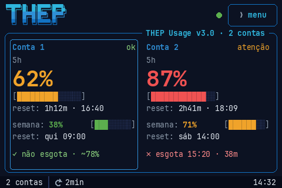
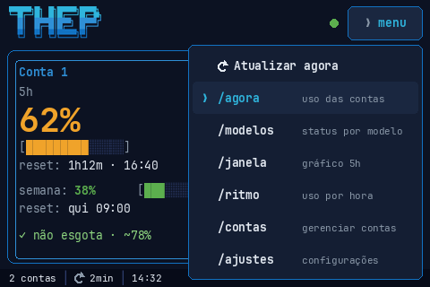
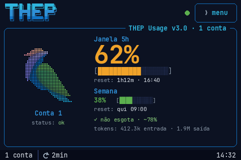
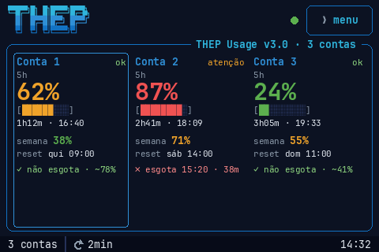
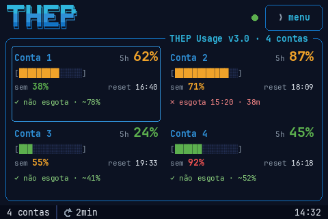
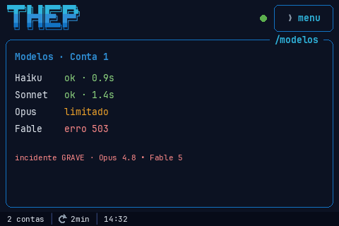
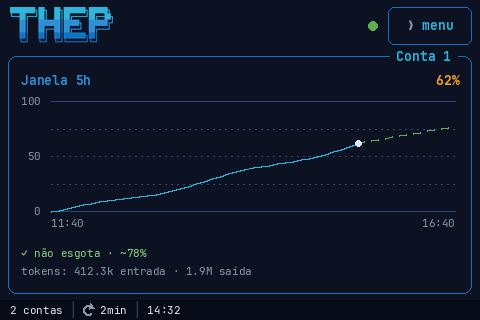
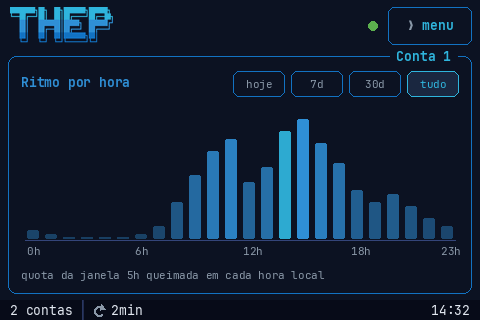
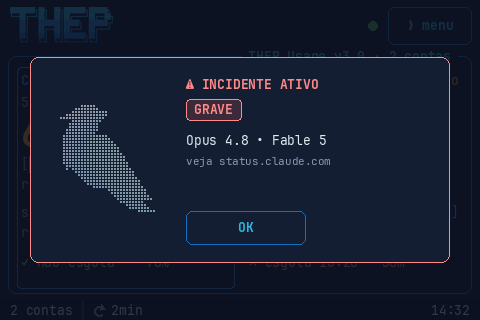
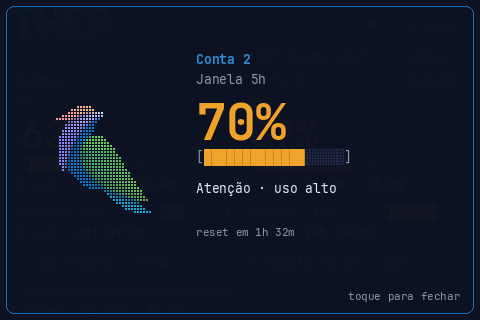

<div align="center">


# Claude Usage Stick

**Seus limites de uso do Claude Code, ao vivo numa tela touch de 3,5".**<br>
Sem computador. Sem app. Sem nuvem.

[English](README.md) · **Português**




</div>

O device consulta a API da Anthropic diretamente, lê o seu uso dos próprios cabeçalhos da resposta
e desenha tudo num painel: **todas as contas salvas lado a lado** (até 4), projeção de consumo,
relógios de reset, uso por hora do dia e um ponto de status que mostra num relance se alguma conta
parou de atualizar.

> Navegação 100% touch por um **menu** no cabeçalho (sem swipe, sem botão físico). A v3 troca o
> visual coral com o Clawd por uma interface de terminal no espírito da CLI do
> [Hermes Agent](https://github.com/NousResearch/hermes-agent), com as cores da **THEP**.
> Adaptado do projeto original **Claude Usage Stick** (um firmware multi-placa com botões físicos)
> para rodar **só nesta tela** — veja [O que veio do projeto original](#o-que-veio-do-projeto-original).

> A interface do device é em português por padrão (o inglês fica a um toque, em Ajustes). Este
> README é a versão em português da documentação; o [README em inglês](README.md) é o principal do
> projeto.

---

## Colocando um para funcionar


Tudo o que você precisa está neste repositório: o código do firmware, a placa exata, o mapa de
pinos e os comandos de build. Gravar você mesmo com o `arduino-cli` está documentado em
[Compilar e gravar](#compilar-e-gravar) e **não custa nada**.

### Não quer instalar um toolchain?

<a href="https://usagestick.autom.my"></a>

Se você está sem tempo — ou simplesmente não quer lidar com `arduino-cli`, pacotes de placa e
bibliotecas — existe um gravador hospedado em
**[usagestick.autom.my](https://usagestick.autom.my)**. Crie uma conta, conecte a placa no USB e o
Chrome grava o firmware direto nela via Web Serial. Leva cerca de um minuto e não instala nada na
sua máquina.

Esse serviço cobra uma **taxa única por placa**, que paga a hospedagem e o trabalho de construir a
facilidade. Para deixar explícito o que está sendo vendido:

- **Você não está pagando pelo firmware.** Ele é aberto, está aqui, e você pode compilar e gravar
  de graça, para sempre, sem criar conta nenhuma.
- A taxa cobre **a conveniência** de fazer isso pelo navegador. É totalmente opcional.
- Um pagamento vale por **uma placa, para sempre** — incluindo versões futuras do firmware nela.

Se você se vira bem num terminal, pule isso e vá para [Compilar e gravar](#compilar-e-gravar).

---

## Telas

> As imagens abaixo são **mockups** gerados pelo `python3 tools/gen_mockups.py` com as próprias
> fontes do firmware (JetBrains Mono, do `tools/gen_fonts.sh`), as imagens
> (`tools/gen_hermes_assets.py`) e a geometria das telas; o script também falha se algum texto
> estourar o card. Fotos reais do device em breve.

Depois do PIN, a tela é um **shell** fixo:

- **Cabeçalho:** o logo THEP, o [ponto de status](#ponto-de-status) e o botão `❯ menu`.
- **Painel:** uma caixa com borda e o título sobre a borda (`THEP Usage v3.0 · 2 contas` na tela
  inicial, o rótulo da conta em foco nas telas por conta).
- **Rodapé:** contas salvas (com `· N ✗` quando N delas estão em falha), o intervalo de consulta e
  o relógio.

As consultas e o servidor web local continuam rodando em qualquer tela.

### Menu


O `❯ menu` abre uma lista sobre a tela atual; tocar num item ou fora dela fecha:

| Item | Abre |
|---|---|
| `↻ Atualizar agora` | consulta agora (sem efeito se um ciclo já está em andamento) |
| `/agora` | tela inicial: uso das contas |
| `/modelos` | status por modelo |
| `/janela` | gráfico da janela de 5h |
| `/ritmo` | uso por hora |
| `/contas` | gerenciar contas |
| `/ajustes` | configurações (o Sobre fica aqui) |

Os comandos não são traduzidos. Não há volta automática para a tela inicial.

<br clear="right">

### Tela inicial (`/agora`)

Um card por conta **salva**, na ordem dos slots. O layout depende de quantas contas estão salvas
(1 a 4). Uma conta em falha continua com a coluna dela, então o layout não pula a cada queda de
rede.

 
 

| Contas | Disposição | Por conta |
|---|---|---|
| 1 | Pássaro THEP em braille + seções | rótulo e marca da API sob o pássaro; % da 5h em 50 px, barra de 18 blocos, reset (`1h12m · 16:40`), % da semana com barra de 10 blocos, reset da semana (`qui 09:00`), projeção e a [contagem de tokens](#tokens-por-sessão-ponte-opcional) quando a ponte está rodando |
| 2 | 2 colunas | rótulo + marca da API; % da 5h em 38 px, barra de 14 blocos, reset, % da semana + barra de 8 blocos, reset da semana, projeção (texto secundário em 13 px, linhas distribuídas pela altura do card) |
| 3 | 3 colunas | rótulo (até 10 caracteres) + marca da API; % da 5h em 30 px, barra de 9 blocos, reset, % da semana, reset da semana, projeção |
| 4 | Grade 2×2 | rótulo + % da 5h (20 px) na mesma linha, barra de 14 blocos, % da semana + hora do reset da 5h, projeção; sem espaço para a marca, então `atenção`/`limite` pintam a % da 5h de âmbar/vermelho |

- **Níveis** são degraus fixos, para as duas janelas: verde abaixo de 50%, âmbar de 50% a menos de
  80%, vermelho a partir de 80%.
- A **marca da API** vem de `anthropic-ratelimit-unified-status`: `allowed` → `ok` (verde),
  `allowed_warning` ou qualquer valor com `warning` → `atenção` (âmbar), `rejected` /
  `rate_limited` / `exceeded` → `limite` (vermelho); outro valor aparece como veio, cortado em 8
  caracteres.
- A **projeção** é uma linha, calculada pela mesma função de [`/janela`](#janela-de-5h-janela):
  `✓ não esgota · ~78%` (78% previstos no reset), `✗ esgota 15:20 · 38m` (esgota às 15:20, daqui a
  38 min), `✗ esgotada`, `— sem histórico` (ainda sem amostras suficientes). Quando a hora do reset
  da 5h já passou mas a próxima leitura ainda não chegou, o card diz `— janela reiniciou` e a linha
  de reset mostra `passou · 16:40`, em vez de uma contagem parada.
- **Rótulos** maiores que o card são cortados com `…`.
- **Tocar num card** coloca aquela conta em **foco** (usado por `/modelos`, `/janela` e `/ritmo`).

#### Quando uma conta está em falha

O card nunca vira uma tela de erro. Nesta precedência:

1. Slot que não decifrou com este PIN: `SEM CHAVE`.
2. Em falha e sem nenhum dado ainda (por exemplo, a primeira consulta depois de trocar o token
   voltou 401): `⚠ AUTH` no lugar da projeção e `--%` no lugar da % da 5h.
3. Em falha, com dado anterior: os últimos valores ficam na tela, esmaecidos, e a linha de projeção
   vira `⚠ <classe> · <idade dos dados>`, por exemplo `⚠ AUTH · 4m`.
4. Ainda não consultada (logo após o desbloqueio, ou token novo): `consultando…` com `--%`.

| Classe | Significado |
|---|---|
| `AUTH` | 401 / 403 (a conta entra em espera crescente: pula 1, 2, 4… ciclos, até 30 min, até o token ser trocado) |
| `RATE` | 429 sem os cabeçalhos de uso |
| `ERR` | qualquer outro 4xx, 3xx, ou 200 sem os cabeçalhos de uso |
| `SRV` | 5xx |
| `NET` | timeout, DNS, TLS, sem código HTTP |
| `NOWIFI` | WiFi caiu (o device continua tentando as redes salvas) |
| `NOCLOCK` | sem hora do NTP por mais de 60 s depois de o WiFi conectar (o TLS não funciona sem relógio) |

Um 429 **com** os cabeçalhos de uso é dado válido (a conta está no limite), não falha.

#### Ponto de status

O ponto no cabeçalho resume **todas** as contas e pulsa em 4 degraus de opacidade (ciclo de 1,6 s):

| Cor | Quando |
|---|---|
| Vermelho `#f05252` | todas as contas que já responderam estão em falha (inclui sem WiFi) |
| Amarelo `#f0c419` | ao menos uma conta em falha |
| Azul `#2f8fd6` | primeiro ciclo após o desbloqueio ainda em andamento, ou o último ciclo terminou há menos de 10 s com todas as contas OK |
| Verde `#5caf4e` | demais casos |

Uma conta que ainda não respondeu não conta como falha, então logo depois do desbloqueio o ponto
nunca fica vermelho.

### Modelos (`/modelos`)


- Uma lista em texto, uma linha por modelo (Haiku / Sonnet / Opus / Fable), na cor do resultado:
  `ok · 0.9s` (verde, com latência) · `limitado` (âmbar, HTTP 429) · `AUTH` (401/403) · `NET`
  (erro de rede) · `erro <código>` (outros códigos) · `n/d` (HTTP 404, cinza) · `—` (ainda não
  sondado).
- A sonda é **a própria consulta de uso da conta em foco**: a cada ciclo ela usa o próximo modelo do
  rodízio no lugar do modelo fixo. Se esse modelo responde sem os cabeçalhos de uso, a conta é
  consultada de novo na hora com o modelo fixo, então um modelo fora do ar nunca deixa a conta em
  falha.
- A última linha é o `status.claude.com`: `sem incidentes`, ou a gravidade do incidente e os modelos
  que ele cita.
- O título do painel é o rótulo da conta em foco; tocar nele passa para a próxima conta.

<br clear="right">

### Janela de 5h (`/janela`)


- Gráfico da conta em foco com o **eixo X cobrindo exatamente a janela de 5h atual** (início →
  reset).
- Linha contínua = histórico real de uso; **linha tracejada = projeção** no ritmo atual.
- A legenda é o mesmo texto de projeção dos cards da tela inicial, com espaço para a frase inteira.
- A [contagem de tokens](#tokens-por-sessão-ponte-opcional) também aparece aqui quando a ponte está
  rodando.

<br clear="right">

### Ritmo por hora (`/ritmo`)


- **Uso por hora do dia** da conta em foco: 24 barras mostrando quais horas queimam mais quota; a
  hora atual fica destacada.
- **Seletor de período**: **hoje / 7d / 30d / tudo**. O histórico por dia é **persistido na
  flash** (31 dias por conta).

<br clear="right">

### Aviso de incidente


Quando o `status.claude.com` reporta um **incidente não resolvido** em algum modelo, um aviso abre
sobre qualquer tela: *"⚠ INCIDENTE ATIVO"*, com o pássaro THEP em cinza e *"veja
status.claude.com"*. Ele responde à pergunta que importa na hora em que algo trava: **é você ou é a
Anthropic?**

A **gravidade** que o Statuspage informa no campo `impact` do incidente vira um **chip** abaixo do
título, e pinta a borda e o título:

| `impact` | chip | cor |
|---|---|---|
| `minor` | `LEVE` | âmbar `#f0a32a` |
| `major` | `GRAVE` | vermelho claro `#ff8a8a` |
| `critical` | `CRÍTICO` | vermelho `#f05252` |
| `none` / ausente | `IMPACTO NÃO DECLARADO` | âmbar `#f0a32a` |

**Todo incidente que cita um modelo abre o aviso** — nenhum é suprimido em silêncio. Quando não há
gravidade utilizável, o chip diz isso abertamente em vez de sumir.

Abaixo do chip vêm os **modelos citados** pelo incidente, com a **versão** quando o texto do
incidente diz qual (`Opus 4.6 • Sonnet 4.5`). Com as quatro famílias afetadas, a linha vira
`Todos`. Sem nenhum modelo citado, a linha some — melhor omitir do que inventar.

Toque em qualquer lugar (ou em `OK`) para dispensar. Ele **não volta a incomodar** durante aquele
incidente — só reaparece se o incidente for resolvido e surgir um novo, **ou se a gravidade
aumentar** (um `minor` que vira `critical` alerta de novo mesmo depois de dispensado). Se a
gravidade mudar com o aviso aberto, ele é redesenhado na nova cor.

<br clear="right">

### Momentos de limiar


Sempre que a janela de 5h ou a semana de uma conta cruza **25% / 50% / 70% / 100%**, aparece um
"momento" de tela cheia com o pássaro THEP, o rótulo da conta, a porcentagem contando e uma barra
de blocos acendendo. O pássaro quica em 25% e 50%, treme em 70% e fica cinza em 100%. Toque para
fechar (fecha sozinho depois de 4,6 s).

Os limiares são **por conta**. Se várias contas cruzam algum no mesmo ciclo, só aparece o maior;
os outros ficam marcados como disparados e não se repetem.

Ordem de empilhamento, de baixo para cima: menu, momento de limiar, aviso de incidente.

<br clear="right">

### Ajustes (`/ajustes`)

Uma lista rolável, nesta ordem:

- **Atualizar agora**.
- **Atualizar a cada** — 30 s / 1 min / 2 min / 5 min, toque para alternar (padrão 2 min; salvo na
  NVS).
- **Idioma** — Português / English, aplicado à interface inteira.
- **Fuso** — toque para alternar entre GMT−3, −4, −5, −6, −7, −8, −2, −1, 0, +1, +2, +3 (padrão
  GMT−3). Não há nada além de GMT+3 nem abaixo de GMT−8.
- **Brilho** — baixo / médio / alto.
- **Configurar WiFi** — novo scan + senha na tela. Enquanto essa tela usa o rádio, as consultas
  param (ela mostra *"aguardando a rede…"* até a consulta em andamento terminar) e voltam quando
  você sai.
- **Contas** — `N/4`, abre [`/contas`](#contas-contas).
- **Trocar token** — reabre a entrada de token pela web para a conta **em foco**.
- **Sobre** — informações do device, versão do firmware, modelo do display e créditos.
- **Apagar tudo** — reset de fábrica (2 toques para confirmar).

O slideshow da v2.3 saiu; a chave dele na NVS continua lá (e é ignorada) para um rollback
encontrá-la.

### Contas (`/contas`)

Tem uma assinatura do Claude pessoal **e** uma do trabalho? O device guarda **até 4**, cada uma com
seu rótulo e seu slot criptografado, todas atrás do mesmo PIN.

- **Toque numa linha para colocá-la em foco.** A conta em foco fica destacada e marcada com
  `•  foco`. O foco só decide qual conta `/modelos`, `/janela` e `/ritmo` mostram (e qual leva a
  sonda de modelos); **todas as contas são consultadas de qualquer jeito**.
- **O lápis renomeia** na tela; nomes repetidos ganham o sufixo " 2" automaticamente, porque a
  [ponte de tokens](#tokens-por-sessão-ponte-opcional) identifica as contas pelo rótulo.
- **A lixeira remove** (2 toques para confirmar), e não deixa apagar a última. Um resultado ainda em
  andamento de uma conta removida é descartado.
- **+ Adicionar conta** reaproveita o formulário web, que recebe um rótulo junto com o token.

---

## Hardware

| | |
|---|---|
| Tela | **Mini ESP32-S3 3.5" Capacitive Touch IPS · 480×320 · 8 MB PSRAM · 16 MB Flash** ([AliExpress](https://s.click.aliexpress.com/e/_c4T3hoZp)) |
| Chip | ESP32-S3 (USB nativo) |
| Display | **AXS15231B**, interface QSPI |
| Touch | **AXS15231B** capacitivo, I²C `0x3B` |

> **Aviso:** o link do AliExpress acima é um link de afiliado. Você não paga nada a mais, e a pequena
> comissão volta direto para manter este projeto vivo e atualizado. Comprar a placa por ele é uma
> forma simples de contribuir — obrigado!

> **PSRAM OPI é obrigatória** — o buffer LVGL de 480×320 não cabe na RAM interna.

Os pinos e a configuração validada de display/cores/touch estão em
[`firmware/REFERENCIA-HARDWARE-LVGL.md`](firmware/REFERENCIA-HARDWARE-LVGL.md), e o sketch de
bring-up de referência em [`firmware/bringup/`](firmware/bringup/).

Os fontes do firmware e o `firmware/REFERENCIA-HARDWARE-LVGL.md` chamam a placa de **Guition
JC4832W535**; os vendedores e o case abaixo usam **JC3248W535C**. Os dois nomes se referem à mesma
placa ESP32-S3 + AXS15231B de 3,5" (contribuidores rodaram o firmware em placas vendidas como
JC3248W535C).

### Case para impressão 3D

Um case pronto para imprimir para esta placa está incluído:
[`3D Case/Case_JC3248W535C.stl`](3D%20Case/Case_JC3248W535C.stl) — imprima, encaixe a placa e o
Usage Stick está pronto para a mesa.

---

## Como funciona (e o token)

O gadget faz um `POST` **mínimo** (`max_tokens: 1`) para
`https://api.anthropic.com/v1/messages` e **não usa o corpo da resposta** — ele lê o uso direto dos
cabeçalhos (`src/net/api.cpp`):

```
anthropic-ratelimit-unified-status                allowed | allowed_warning | rejected  (a marca da API)
anthropic-ratelimit-unified-5h-utilization        0–1   (vira a % da janela de 5 horas)
anthropic-ratelimit-unified-5h-reset              epoch
anthropic-ratelimit-unified-5h-status
anthropic-ratelimit-unified-7d-utilization        0–1   (janela de 7 dias)
anthropic-ratelimit-unified-7d-reset              epoch
anthropic-ratelimit-unified-7d-status
anthropic-ratelimit-unified-reset                 epoch
anthropic-ratelimit-unified-representative-claim  five_hour | seven_day  (o que te limita primeiro)
anthropic-ratelimit-unified-fallback-percentage
anthropic-ratelimit-unified-overage-status / -overage-disabled-reason
```

**Toda conta salva é consultada uma vez por ciclo**, uma requisição por vez, numa task de rede
separada, então a tela continua respondendo ao toque durante as consultas. Um novo ciclo começa um
intervalo **depois do fim do anterior** (sem sobreposição). Cada requisição tem timeout de 5 s para
conectar, 5 s para o handshake TLS e 8 s de leitura; se uma requisição passar de 90 s sem terminar,
o device grava o motivo na NVS e reinicia (o PIN é pedido de novo).

A **sonda por modelo** vai junto com a consulta da conta em foco (veja [`/modelos`](#modelos-modelos)),
então não custa requisição extra no caso normal.

A saúde dos modelos vem de `status.claude.com/api/v2/incidents/unresolved.json`, consultado **a cada
5 minutos** (`STATUS_POLL_SEC`), uma vez para todas as contas. Incidentes não resolvidos citam a
família do modelo no próprio texto, então basta um scan de palavra-chave (`src/net/status.cpp`),
que também extrai o maior `impact` da lista. É isso que dispara o
[aviso de incidente](#aviso-de-incidente).

### Quanto custa consultar todas as contas

Cada consulta é uma requisição real (mínima) à API, **visível para os admins da sua organização**
como qualquer uso do Claude Code. Com todas as contas consultadas, a conta é *contas × ciclos por
hora*:

| Intervalo | 1 conta | 2 contas | 4 contas |
|---|---|---|---|
| 30 s | 120 /h | 240 /h | 480 /h |
| 1 min | 60 /h | 120 /h | 240 /h |
| 2 min (padrão) | 30 /h | 60 /h | 120 /h |
| 5 min | 12 /h | 24 /h | 48 /h |

Some a isso a repetição ocasional quando o modelo do rodízio responde sem os cabeçalhos de uso.
Cada requisição é `max_tokens: 1` com poucos tokens de entrada, então o consumo de quota é
desprezível — mas numa conta corporativa o que os admins veem é o **volume**. A v2.3 consultava só a
conta ativa; se isso importa para você, escolha um intervalo maior ou mantenha menos contas no
device. Uma conta recusada com 401/403 entra em espera crescente sozinha (até 30 min entre
tentativas).

### Tokens por sessão (ponte opcional)

A API **não** expõe contagem de tokens para contas de assinatura — os cabeçalhos `unified-*` só
trazem porcentagens de utilização, e `/api/oauth/usage` exige o escopo `user:profile` (o
`setup-token` só tem `user:inference`) e ainda assim devolve porcentagens. Os números reais vivem
nos **transcripts locais do Claude Code** (`<pasta de config>/projects/**/*.jsonl`, `~/.claude` por
padrão).

O [`tools/token_bridge.py`](tools/token_bridge.py) (só stdlib) fecha essa lacuna: ele pergunta ao
device qual é a janela atual da conta (`GET http://claude-stick.local/window?account=<rótulo>`),
soma as entradas `usage` dos transcripts desde o início da janela (deduplicadas por id de mensagem,
procurando em todas as subpastas de `projects/`) e devolve o total (`POST /tokens`). A tela inicial
de 1 conta e a `/janela` passam a mostrar *"tokens: 1.2M entrada · 88k saída"*. A contagem some
quando fica velha (mais de 15 min sem envio).

O payload leva `in` (tokens de entrada + criação de cache), `out`, `cache` (leituras de cache) e
`sessions`; o device guarda os quatro e mostra `in`/`out`.

```bash
python3 tools/token_bridge.py                              # uma vez, conta em foco
python3 tools/token_bridge.py --loop 120                   # continua enviando a cada 2 min
python3 tools/token_bridge.py --host 192.168.0.42          # se o mDNS não resolver
```

O device se anuncia por mDNS como **`claude-stick.local`** assim que entra no WiFi.

**Contrato do device (v3):**

- `GET /window` devolve a janela da conta em foco; `GET /window?account=<rótulo>` devolve a dessa
  conta, ou **404** se nenhuma conta tem esse rótulo.
- `POST /tokens` com `"account": "<rótulo>"` vai para a conta com exatamente esse rótulo
  (diferenciando maiúsculas); sem `account`, vai para a conta em foco. Rótulo desconhecido recebe
  **404**. O `409 account_mismatch` da v2.3 deixou de existir.

#### Várias contas no mesmo computador

Cada conta precisa dos próprios transcripts, então rode o Claude Code de cada uma com o próprio
`CLAUDE_CONFIG_DIR` e dê a cada uma a própria ponte, com `--config-dir` (lê `<pasta>/projects` em
vez de `~/.claude/projects`) e `--account` (o rótulo configurado no gadget):

```bash
# ~/.zshrc — uma pasta de config do Claude Code por conta
alias claude-trabalho='CLAUDE_CONFIG_DIR=~/.claude-trabalho claude'
alias claude-pessoal='CLAUDE_CONFIG_DIR=~/.claude-pessoal claude'
```

```bash
python3 tools/token_bridge.py --config-dir ~/.claude-trabalho --account Trabalho --loop 120
python3 tools/token_bridge.py --config-dir ~/.claude-pessoal  --account Pessoal  --loop 120
```

Isso muda o jeito de abrir o Claude Code no dia a dia (faça login uma vez dentro de cada alias). Em
máquinas separadas, só o `--account` basta. Se o rótulo não existe no gadget, a ponte avisa e pula
o envio. Uma ponte antiga (sem `?account=`) continua funcionando, mas só para a conta em foco. A
ponte nova também funciona com um device na v2.3: ela confere qual conta a v2.3 informa como ativa
e pula o envio para qualquer outra.

### Atualizando da v2.3 (e da v2.1)

Gravar a v3 por cima da v2.3 mantém as contas, o PIN e o histórico: a tabela de partições, o formato
de `/hist0.bin`..`/hist3.bin` e as chaves da NVS não mudam, e só a partição da aplicação é
reescrita. A "conta ativa" da v2.3 vira a conta em foco da v3.

**Vindo da v2.1?** Nada se perde e nada é pedido de você. O primeiro boot move o token guardado
para o slot 0 (rotulado "Conta 1") e dá a ele uma cópia do histórico existente. Os dois originais
são **mantidos** de propósito, então voltar para a v2.1 encontra tudo onde estava — a migração só
acrescenta.

### Gerando o token (`claude setup-token`)

Num terminal, com o **Claude Code** instalado e logado na sua assinatura (**Pro** ou **Max**):

```bash
claude setup-token
```

Isso abre um fluxo **OAuth** no navegador; você autentica com sua conta Anthropic e recebe um
**token de longa duração** no formato `sk-ant-oat01-…`.

Ele foi pensado para ambientes **sem login interativo** (CI/CD, GitHub Actions, scripts headless) —
o uso típico é como variável de ambiente:

```bash
export CLAUDE_CODE_OAUTH_TOKEN="sk-ant-oat01-..."
```

**⚠️ Ressalva importante:** esse é um token do **Claude Code**. Uma chamada "crua" à Messages API
(`/v1/messages`) com ele normalmente é **rejeitada**.

**Como este gadget contorna isso:** ele manda exatamente os cabeçalhos que o Claude Code manda —
`anthropic-beta: oauth-2025-04-20` mais o `User-Agent` do Claude Code — numa requisição
`max_tokens: 1`. A API então responde **200** e devolve os cabeçalhos de rate limit (validado
contra uma conta real). Como o corpo é descartado e é só 1 token, o **consumo de quota é
desprezível**.

> O token é digitado **uma vez** (pela web, veja abaixo) e guardado **criptografado** no device.

### 🚨 Leia isto antes de usar um token de assinatura

**A Anthropic não permite tokens OAuth de assinatura em ferramentas de terceiros.** Numa política
formalizada em **4 de abril de 2026**, a Anthropic afirmou que o OAuth de Free/Pro/Max — a
credencial que o `claude setup-token` produz — se destina **apenas** ao Claude Code e ao claude.ai,
e que usá-la em qualquer outro produto, ferramenta ou serviço viola os Termos ao Consumidor. Há
relatos de aplicação da regra no servidor desde janeiro de 2026.

Este firmware é uma ferramenta de terceiros, e a solução descrita logo acima — imitar o cliente
Claude Code pelos cabeçalhos e pelo User-Agent — é exatamente o padrão de que a política trata.

**O que isso significa na prática:**

- **Funciona hoje.** Uma placa foi gravada em agosto de 2026 e mostra dados reais. Mas *funcionar*
  não é *ser permitido*.
- A exposição é da **sua conta**, não do projeto. Relatos públicos de aplicação incluem falhas de
  autenticação e interrupção de conta.
- A Anthropic pode mudar a API ou bloquear o padrão a qualquer momento, e o device simplesmente
  pararia de mostrar números.

Este projeto não tem vínculo com a Anthropic e não fala por ela. Ele é publicado para que as
pessoas possam construí-lo, ler o código e decidir por si mesmas. **Se você não está disposto a
aceitar esse risco na sua própria conta, não use um token de assinatura com este firmware.**

Fontes, levantadas em 13 de agosto de 2026:
[The Register](https://www.theregister.com/2026/02/20/anthropic_clarifies_ban_third_party_claude_access/) ·
[WinBuzzer](https://winbuzzer.com/2026/02/19/anthropic-bans-claude-subscription-oauth-in-third-party-apps-xcxwbn/)

---

## Compilar e gravar

> Prefere não montar nada disso? O [usagestick.autom.my](https://usagestick.autom.my) grava a placa
> pelo Chrome, sem instalar nada — veja
> [Não quer instalar um toolchain?](#não-quer-instalar-um-toolchain). O caminho abaixo é o gratuito
> e sempre será.

Pré-requisitos (versões testadas):

- `arduino-cli` 1.4.x · core `esp32:esp32` **3.3.8** (a versão em que a v3 foi validada)
- bibliotecas: **GFX Library for Arduino** 1.6.5 · **lvgl** 9.2.2

```bash
cd firmware/claude_stick
./build.sh                          # compila (saída em build/; falha se o app passar de 2,8 MB)
./build.sh upload                   # compila + grava (porta padrão /dev/cu.usbmodem101)
./build.sh upload /dev/cu.usbmodemXXXX
./build.sh dev                      # compila com -DTHEP_DEV (rotas e logs de diagnóstico)
./build.sh upload-dev [porta]       # idem, e grava
./build.sh monitor /dev/cu.usbmodemXXXX
THEP_FLAGS="-D..." ./build.sh ...   # flags extras de compilação para experimentos
```

Da raiz do repositório, o `./flash.sh` acha a porta da placa sozinho e roda o `build.sh upload`.

A build `THEP_DEV` acrescenta o `GET /health` (heap, PSRAM, memória do LVGL, stack da task de rede,
tempos de ciclo e de quadro, classe por slot — nunca tokens nem rótulos) e mais logs no serial. A
build normal imprime o log de ciclo (`[CYC]`, `[HEAP]`) de qualquer forma.

Testes no computador (a lógica pura de `src/logic/`, mais uma checagem de que o código de rede
nunca chama o LVGL):

```bash
firmware/tests/run.sh               # g++ com C++17
```

FQBN: `esp32:esp32:esp32s3:PSRAM=opi,FlashSize=16M,PartitionScheme=custom,CDCOnBoot=cdc,USBMode=hwcdc,FlashMode=qio`

O `build.sh` passa `-DLV_CONF_INCLUDE_SIMPLE -I<sketch> -I<sketch>/src` (nas flags de C, C++ **e**
assembler) para o LVGL achar o `lv_conf.h` do sketch e os módulos se incluírem pelo caminho a
partir de `src/`.
Se você receber `lv_conf.h not found`, copie `firmware/claude_stick/lv_conf.h` para a pasta de
bibliotecas do Arduino (um nível acima da pasta `lvgl`) — copie **este** arquivo, não um mais
antigo: o `#include <stdint.h>` dele está dentro de uma guarda `#ifndef __ASSEMBLY__`, sem a qual o
build morre ao montar os `lv_blend_helium.S` / `lv_blend_neon.S` do lvgl:

```
xtensa-esp-elf/include/stdint.h:21: Error: unknown opcode or format name 'typedef'
```

Essa guarda é o que o próprio `lv_conf_template.h` do lvgl prescreve, e ela é necessária porque o
`lv_conf_internal.h` puxa o `lv_conf.h` *inclusive durante a montagem* daqueles arquivos `.S`.

Uma sutileza que vale conhecer se você compila outros sketches nesta placa: o `-I` acima viaja em
`compiler.c/cpp.extra_flags`, e o core ESP32 monta arquivos `.S` com `compiler.S.extra_flags`. Um
sketch que traz o próprio `lv_conf.h` fica bem (a pasta do sketch está no include path de qualquer
jeito), mas um sketch **sem** ele cai no `../../lv_conf.h` do lvgl — aquele arquivo solto em
`libraries/`, que pode muito bem pertencer a outro projeto. Se você bater no erro acima a partir de
um sketch sem `lv_conf.h`, passe o `-I` também em `compiler.S.extra_flags`; o
`firmware/bringup/build.sh` faz exatamente isso.

Para compilar o sketch de bring-up, use o script dele — `firmware/bringup/build.sh`. Aquela pasta
não tem `partitions.csv` nem `lv_conf.h`, então a FQBN do firmware não se aplica a ela.

> Se as cores saírem com vermelho e azul trocados, mude `LV_COLOR_16_SWAP` para `1` no `lv_conf.h`.

As fontes, as imagens THEP e os mockups do README são arquivos gerados; os geradores e as
dependências deles estão descritos no [`firmware/README.md`](firmware/README.md).

### Rollback para a v2.3

A v3 não muda a tabela de partições nem os formatos de dados, então voltar é **gravar só a partição
de app** da v2.3. Nunca use `erase_flash` (nem qualquer opção de "apagar tudo"): isso apaga as
contas, o PIN e o histórico.

```bash
# opção 1: recompilar a v2.3 a partir da tag (usa o build.sh da própria v2.3)
git checkout v2.3
firmware/claude_stick/build.sh upload /dev/cu.usbmodemXXXX
git checkout -        # volta para onde você estava

# opção 2: gravar um binário de app da v2.3 guardado direto no app0
esptool --chip esp32s3 -p /dev/cu.usbmodemXXXX write-flash 0x10000 claude_stick.ino.bin
```

(O `esptool` vem com o core, em `~/Library/Arduino15/packages/esp32/tools/esptool_py/` no macOS.) A
v2.3 abre pedindo o PIN, a conta em foco da v3 vira a conta ativa e o histórico continua lá. A v2.3
volta a consultar só essa conta.

---

## Primeira configuração (onboarding)

Tudo pela tela / rede — sem precisar recompilar:

1. **WiFi** — toque na sua rede e digite a senha (teclado na tela). Guarda até 3 redes na NVS.
2. **Token** — a tela mostra o **IP do gadget** (por exemplo `http://192.168.0.42`). Abra esse
   endereço **no seu PC ou celular na mesma rede**, opcionalmente dê um **rótulo** à conta
   (*Pessoal*, *Trabalho*) e **cole o token** no formulário. O device **valida** o token com uma
   chamada real à API (a página mostra *"validando…"* e espera a resposta) antes de aceitá-lo.
3. **PIN** — defina um PIN de 4 dígitos (digitado duas vezes para confirmar). O token é
   criptografado com ele.

A cada boot seguinte, o device pede apenas o **PIN**, decifra todas as contas e abre a tela inicial
com todos os cards em `consultando…`. Contas extras adicionadas depois (`/contas`) reaproveitam o
mesmo formulário e são criptografadas com a mesma chave da sessão — sem pedir o PIN de novo durante
a sessão.

---

## Segurança

- Os tokens são guardados **criptografados** (AES-256-GCM), um slot de NVS por conta, todos sob o
  **mesmo PIN**. A chave é derivada do PIN com **10.000 rodadas de SHA-256**, com o **MAC do chip**
  como salt, o que amarra o blob cifrado a esta placa. O PIN **nunca** é armazenado — um PIN errado
  significa que a tag GCM não confere.
- PINs errados bloqueiam o teclado por 60 s, dobrando a cada falha até **1 hora**. Depois de 10
  tentativas erradas, as credenciais são **apagadas** (antes de qualquer token ser decifrado) e o
  device volta ao onboarding.
- Se um slot não decifra mas os outros sim, aquele card mostra `SEM CHAVE` e o resto funciona; se
  nenhum decifra, conta como PIN errado.
- **Até 4 tokens ficam decifrados na RAM** durante a sessão, porque todas as contas são
  consultadas. Eles ficam numa tabela protegida por mutex; a task de rede copia o token para um
  buffer na stack só durante a requisição e o zera no fim, como faz com o buffer do cabeçalho
  `Authorization`. Uma cópia residual fica na string de heap do cliente HTTP até o fim da
  requisição. Remover uma conta, trocar o token dela ou apagar tudo zera o(s) token(s).
- O PIN em si não é guardado: a chave derivada fica na RAM durante a sessão, para cifrar contas
  adicionadas depois sem pedir o PIN de novo. Quem consegue ler a RAM já tem os tokens decifrados de
  qualquer forma.
- Os logs dizem `[slot N]` e nunca imprimem um token; `/window` e `/health` nunca devolvem um.
- Os endpoints da ponte não têm autenticação (como na v2.3): alguém na mesma rede pode falsificar a
  **contagem de tokens** de uma conta, mas não a % de uso, que vem da API.
- O histórico/mapa de calor vive no **LittleFS**, um arquivo por conta (ele não contém o token).
- `.env` e `.mcp.json` estão no `.gitignore` — **nenhum segredo vai para o git**.

---

## O que veio do projeto original

Este é um fork do **Claude Usage Stick** (um firmware multi-placa com botões físicos). A **mecânica
de dados foi reaproveitada** e toda a **camada de hardware/UI foi reescrita** para esta tela.

**Reaproveitado do original (adaptado):**

- A ideia central de **ler o uso dos cabeçalhos** `anthropic-ratelimit-unified-*` com um `POST`
  mínimo (`src/net/api.cpp`).
- A busca de **saúde dos modelos** no `status.claude.com` (`src/net/status.cpp`).
- A **criptografia do token** AES-256-GCM + chave derivada do PIN (`src/sec/crypto.cpp`).
- O **bundle de CAs** para HTTPS (`src/net/certs.cpp`).
- O conceito do produto e a fileira de status dos modelos (os mascotes Clawd viveram aqui até a
  v2.3).

**Reescrito / novo nesta versão:**

- **UI em LVGL 9** para a tela touch — um shell fixo com menu, cards por conta, gráfico e barras por
  hora — no lugar do TFT_eSPI/U8g2 multi-placa.
- **Todas as contas consultadas** numa task de rede FreeRTOS separada, sem HTTPS na thread da
  interface.
- **Build com arduino-cli** para o ESP32-S3 (no lugar do PlatformIO multi-placa).
- **Navegação por toque** em vez de botões físicos.
- **Onboarding na tela + entrada do token pela web** (IP local) em vez de portal cativo.
- Parsing **completo** dos cabeçalhos (status, `representative-claim`, overage, fallback).
- **Histórico/mapa de calor por conta persistidos** (LittleFS), **fuso horário configurável**.

---

## Estrutura do repositório

```
firmware/
  claude_stick/                 # o firmware (sketch do arduino-cli)
    claude_stick.ino            # setup/loop, display/touch, PIN e sessão
    src/
      app/                      # estado e navegação, servidor web local (formulário do token, /window, /tokens)
      hw/                       # driver do touch, gerenciador de WiFi, pool do LVGL na PSRAM, tempo de quadro
      logic/                    # funções puras testadas no computador (projeção, ponto, classes, níveis…)
      model/                    # estado por conta, slots de conta na NVS, histórico no LittleFS
      net/                      # task de rede, agendador, clientes da API e do status.claude.com, tabela de tokens, CAs
      sec/                      # AES-256-GCM + chave derivada do PIN
      ui/                       # shell, menu, telas, overlays, tema, fontes e imagens geradas
    config.h                    # pinos + endpoints + constantes
    lv_conf.h                   # configuração do LVGL 9.2
    partitions.csv              # 16 MB: nvs, otadata, app0 + app1 (3 MB cada), spiffs (LittleFS), coredump
    build.sh                    # compilar / gravar / build dev / monitorar
  tests/                        # testes de computador para src/logic (run.sh)
  bringup/                      # bring-up validado (referência de hardware)
    bringup.ino, config.h, touch.h
    build.sh                    # FQBN própria — veja Compilar e gravar
  README.md                     # módulos do firmware, regra de concorrência, geradores
  REFERENCIA-HARDWARE-LVGL.md   # display/cores/touch que funcionam
tools/
  token_bridge.py               # envia a contagem local de tokens ao device
  test_token_bridge.py          # testes da ponte (python3 tools/test_token_bridge.py)
  gen_fonts.sh                  # JetBrains Mono -> src/ui/fonts/*.c
  gen_hermes_assets.py          # logo THEP + pássaro em braille -> src/ui/assets_thep.{h,c}
  gen_mockups.py                # regenera assets/mock-*.png (as telas)
  gen_banners.py                # regenera assets/banner-*.png (banners do README)
assets/                         # mockups das telas, banners do README + marca (brand/)
3D Case/                        # case imprimível (STL) para a placa
flash.sh                        # acha a porta e roda o build.sh upload
```

Os dois slots de app de 3 MB vêm da tabela de partições, mas não há OTA: o firmware sempre roda do
`app0`, e o `app1` fica sem uso. A tabela fica como está de propósito, porque mudá-la apagaria os
dados no próximo flash.

## Onde mexer

- **Intervalo de consulta, fuso, brilho, idioma:** pela tela (`/ajustes`).
- **Endpoints, timeouts, regras do PIN, consulta do status, tempos do ponto:** `config.h`.
- **Cores e fontes:** `src/ui/theme.h` (papéis da paleta THEP).
- **Layouts da tela inicial:** a tabela `SPEC[]` no topo de `src/ui/screen_home.cpp`.
- **Regras do ponto de status:** `src/logic/dot_state.cpp`; **classes de erro:**
  `src/logic/classify.cpp`.
- **Lista de ajustes:** `screen_settings_build()` em `src/ui/screen_settings.cpp`.
- **Momentos de limiar / aviso de incidente:** `src/ui/overlay_moment.cpp` /
  `src/ui/overlay_incident.cpp` (`incident_sync()`).
- **Textos da tela:** `src/ui/i18n.h` e as chamadas `TRS("pt", "en")` em cada tela.

---

## Créditos

Fork do **Claude Usage Stick** original. O firmware desta versão foi reescrito para a tela LVGL
480×320 do ESP32-S3. Não é um produto oficial da Anthropic.

### Contribuidores

Por um tempo este projeto compilava em exatamente uma máquina no mundo — a minha. Obrigado a quem
descobriu isso e corrigiu, e a quem ensinou um truque novo a ele:

- **[@jzimath-lab](https://github.com/jzimath-lab)** — [#1](https://github.com/benevid/claude-usage-stick-SVGL/pull/1),
  merged. Rastreou por que o firmware não compilava em lugar nenhum: o `#include <stdint.h>` do
  `lv_conf.h` precisa de uma guarda `#ifndef __ASSEMBLY__`, porque o `lv_conf_internal.h` puxa esse
  header *durante a montagem* dos arquivos `.S` do lvgl. Também percebeu que
  `AXS15231B_Touch::_instance` é uma definição dentro de um header, o que só passou despercebido
  enquanto o sketch era uma única unidade de tradução.
- **[@mpsd18](https://github.com/mpsd18)** — [#3](https://github.com/benevid/claude-usage-stick-SVGL/pull/3).
  Chegou à mesma causa raiz de forma independente e explicou a peça que mais ninguém explicou: o
  include path viaja em `compiler.c/cpp.extra_flags`, enquanto o core ESP32 monta arquivos `.S` com
  `compiler.S.extra_flags`. É por causa dessa análise que o `firmware/bringup/build.sh` passa a flag
  nos três, e é a razão de o fallback do Windows em *Compilar e gravar* estar documentado como está.
- **[@ViniciusLoureiro67](https://github.com/ViniciusLoureiro67)** — [#4](https://github.com/benevid/claude-usage-stick-SVGL/pull/4).
  Uma terceira confirmação independente, num JC3248W535C, e fechou a duplicata por conta própria,
  apontando para a #1. Três pessoas chegando à mesma causa a partir de três ambientes é o que tornou
  óbvio que o problema estava aqui, não lá.
- **[@renanravelli](https://github.com/renanravelli)** — [#2](https://github.com/benevid/claude-usage-stick-SVGL/pull/2),
  merged. Suporte a múltiplas contas: até 4 contas, só a ativa consultada, histórico por conta,
  renomear na tela e a flag `--account` na ponte de tokens.
